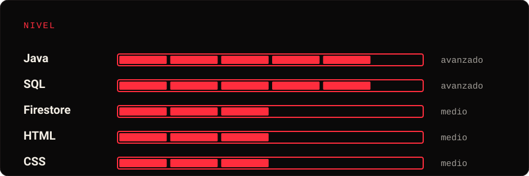
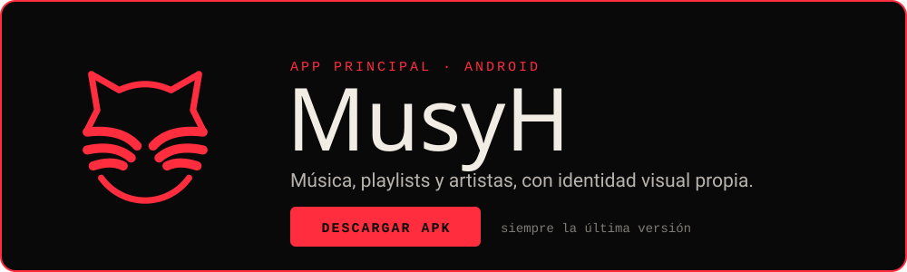
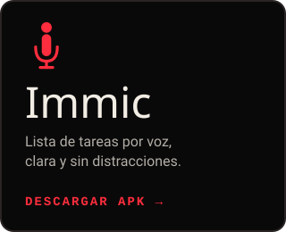
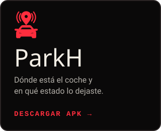
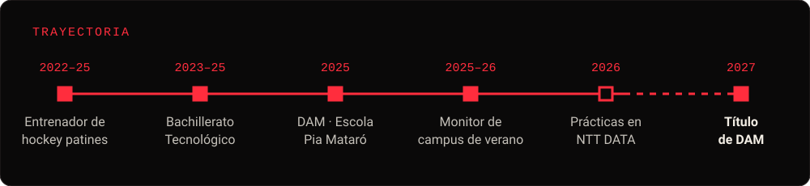

<!-- HEADER: los logos de MusyH, ParkH, Immic y No Ads se dibujan uno tras otro, con su "DESCARGA ..." pasando debajo -->

<picture>
  <source media="(prefers-color-scheme: dark)" srcset="assets/v6/header-dark.svg">
  <source media="(prefers-color-scheme: light)" srcset="assets/v6/header-light.svg">
  
</picture>

##  Sobre mí

Estudiante de segundo de **DAM** en Escola Pia Mataró, de prácticas en **NTT DATA Barcelona**. Tengo buena base en **Java y SQL**, trabajo con **Firebase** y uso **IA generativa** para especificar, iterar y probar mis aplicaciones.

Fuera de clase diseño y publico mis propias apps para Android. Fuera del código, entrenador de hockey patines y monitor de campus de verano.

> *«Si hay una forma más simple de hacerlo, todavía no he terminado.»*

##  Ahora mismo

<table>
  <tr>
    <td width="33%" valign="top"><b>CONSTRUYENDO</b> MusyH, mi app de música, versión a versión</td>
    <td width="33%" valign="top"><b>ESTUDIANDO</b> Segundo de DAM en Escola Pia Mataró</td>
    <td width="33%" valign="top"><b>DE PRÁCTICAS</b> NTT DATA Barcelona</td>
  </tr>
</table>

##  Stack

##  Mis apps para Android

<!-- APP PRINCIPAL -->

<table>
  <tr>
    <td width="33%"></td>
    <td width="33%"></td>
    <td width="33%"></td>
  </tr>
</table>

##  Proyectos de clase

| Proyecto | Descripción | Tecnología |
|---|---|---|
| **[Ajedrez](https://github.com/PolHernaez/PE07-Escacs)** | Juego completo de ajedrez con tests JUnit | Java · JUnit |
| **[Juego de la Oca](https://github.com/PolHernaez/PE6--Joc-de-l-oca-Pol-Hernaez)** | Implementación del juego de mesa clásico | Java |

##  Trayectoria

##  En GitHub

<picture>
  <source media="(prefers-color-scheme: dark)" srcset="https://github-readme-stats.vercel.app/api?username=PolHernaez&show_icons=true&hide_border=true&count_private=true&bg_color=0A0909&title_color=FF2D3D&icon_color=FF2D3D&text_color=F2EDE4">
  
</picture>
<picture>
  <source media="(prefers-color-scheme: dark)" srcset="https://streak-stats.demolab.com?user=PolHernaez&hide_border=true&background=0A0909&ring=FF2D3D&fire=FF2D3D&currStreakLabel=FF2D3D&currStreakNum=F2EDE4&sideNums=F2EDE4&sideLabels=F2EDE4&dates=8C8680&stroke=2A2424">
  
</picture>

<!-- La genera .github/workflows/snake.yml en la rama "output" cada día -->
<picture>
  <source media="(prefers-color-scheme: dark)" srcset="https://raw.githubusercontent.com/PolHernaez/PolHernaez/output/snake-dark.svg">
  
</picture>

##  Contacto

<!-- Si quieres añadir LinkedIn, copia la insignia de arriba y cambia el texto, el logo (linkedin) y el enlace -->

