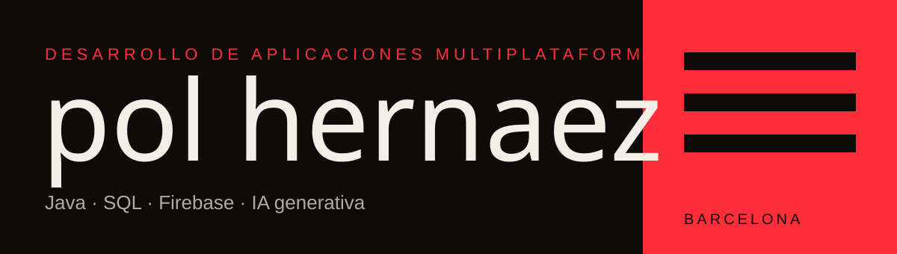

## Sobre mí

Estudiante de segundo de **DAM** (Escola Pia Mataró) con prácticas en **NTT DATA Barcelona**. Buena base en Java y SQL, y uso IA generativa a diario para especificar, iterar y probar aplicaciones. Busco entrar en un equipo de IA donde crecer, aprender APIs REST y construir soluciones a problemas reales.

## Stack

## Proyectos

| Proyecto | Descripción | Tecnología |
|---|---|---|
| **[Ajedrez](https://github.com/PolHernaez/PE07-Escacs)** | Juego completo de ajedrez con tests JUnit | Java · JUnit |
| **[Juego de la Oca](https://github.com/PolHernaez/PE6--Joc-de-l-oca-Pol-Hernaez)** | Implementación del juego de mesa clásico | Java |

## Mis apps para Android

<table>
  <tr>
    <td align="center" width="25%"><h3>MusyH</h3>Música, playlists y artistas  </td>
    <td align="center" width="25%"><h3>Immic</h3>Lista de tareas por voz  </td>
    <td align="center" width="25%"><h3>ParkH</h3>Dónde está el coche y cómo lo dejaste  </td>
    <td align="center" width="25%"><h3>No Ads</h3>Bloqueador de anuncios y DNS cifrado  </td>
  </tr>
</table>

## GitHub

  
  

## Contacto

